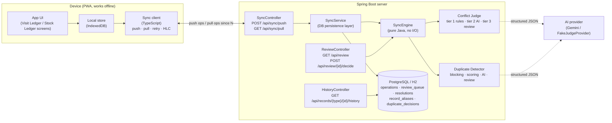

# Design Document: Sync Engine & Conflict Judge

## Overview

Doppelgänger is an offline-first sync skeleton for field apps used in areas with unreliable internet (rural health workers, village shopkeepers). Each field worker's device runs a Progressive Web App (PWA) that works fully offline and syncs to a central Spring Boot server when connectivity is available.

The key insight distinguishing Doppelgänger from generic sync engines is a **three-tier Conflict Judge**: deterministic rules handle simple conflicts, an AI judge handles ambiguous free-text fields, and safety-critical fields (medicine doses, prices) are never auto-merged but escalated to a human reviewer. A secondary pipeline detects **duplicate records** — the same person or item registered separately on two devices — using phonetic matching, scoring, AI, and human review.

The system is **domain-agnostic**. App-specific behaviour (record types, fields, merge policies, invariants, duplicate identity fields) lives entirely in a YAML domain spec. Two demo apps prove this: **Visit Ledger** (patient visits) and **Stock Ledger** (shop inventory). Both run on the same shared `skeleton/server`.

### Key design decisions

- **Append-only operation log as single source of truth.** Every change is an `Operation`; every resolution is also written as a new `Operation`. Replaying the log on any device or after a server restart always produces the same state without calling the AI or judge again.
- **Three-way compare, not last-write-wins.** The server holds a base version for every record. A conflict only exists when *both* sides changed the same field from the same base. Unrelated field edits never conflict.
- **Hybrid logical clocks (HLC).** Phone clocks drift. HLC combines physical time with a logical counter so operations order consistently across devices even when wall clocks are wrong.
- **Tombstones, not deletes.** Deleted records are marked with a tombstone so the deletion propagates to every device. A delete-vs-edit conflict keeps the record and routes to review.
- **Deterministic fake AI for tests.** The `AiJudgeProvider` interface lets property-based tests use a `FakeJudgeProvider` that returns deterministic results, enabling 10,000+ fast scenarios without network calls.

---

## Architecture



### Module breakdown

| Package | Responsibility |
|---|---|
| `core` | Pure-Java engine: `SyncEngine`, `Replica`, `RecordState`, `FieldState`, `Hlc`, `HlcClock`, `DomainSpec`, `RecordSpec`, `Invariant`, `Operation`, `LogEntry`, `Resolution`, `ReviewItem`. No Spring, no I/O. |
| `server` | Spring Boot wiring: `SyncController`, `SyncService`, `OperationEntity`, `OperationRepository`, `BuiltInSpecs` (temporary until YAML loader). |
| `sim` | In-memory fake device and network: `SimDevice`, `Simulation`. Used by property-based tests and later by the demo view. |
| `judge` | AI judge integration: `AiJudgeProvider`, `GeminiJudgeProvider`, `FakeJudgeProvider`, `FieldConflict`, `FieldVerdict`, `DuplicatePair`, `MatchVerdict`. |
| `dup` | Duplicate detector: `DuplicateDetector`, `PhoneticMatcher`, `MatchScorer`, `DuplicateCandidate`. |
| `spec` | Domain spec YAML loading and validation: `DomainSpecLoader`, `IdentityFieldSpec`, `MatchMethod`. |

---

## Components and Interfaces

### SyncEngine

The merge engine is a **pure-Java class with no framework dependency**. Both the Spring server and the simulator use the same instance. It owns the in-memory append-only log and decides, once, what each pushed operation means. The decision is written back into the log so replaying never re-judges.

```java
public final class SyncEngine {
    public SyncEngine(DomainSpec spec) { ... }

    // Rebuild from stored entries — never re-judges.
    public static SyncEngine restore(DomainSpec spec, List<LogEntry> entries) { ... }

    // Accept a device batch. Resending the same opIds is safe.
    public synchronized PushResult push(List<Operation> ops) { ... }

    // All entries after the given log position.
    public synchronized List<LogEntry> pull(long since) { ... }

    // Current log head (number of entries).
    public synchronized long head() { ... }

    // A snapshot copy of the materialised state.
    public synchronized Replica snapshot() { ... }

    // All items waiting for a human reviewer.
    public synchronized List<ReviewItem> openReviews() { ... }

    // Conflicts resolved since creation (not persisted in-process restorations).
    public synchronized List<Resolution> resolutions() { ... }
}
```

**Three-way compare logic** (inside `processSet`):
1. If `server == base`: only the device changed it → `APPLIED`.
2. If `incoming == base`: only the server changed it → `NO_CHANGE`.
3. If `incoming == server` (and not `COUNTER`): both made the same change → `NO_CHANGE`.
4. Otherwise → conflict, dispatched to `judge()`.

**`SyncEngine.push()` is synchronous and I/O-free.** It never calls `AiJudgeProvider` itself. When a conflict is on an `ai-judge` field, `push()` appends the operation with `Disposition.DISPUTED` and adds a `ReviewItem` to the open review list. The AI is called by `SyncService` after `push()` returns.

**AI resolution flow (handled by `SyncService`, not `SyncEngine`):**

```
Device → push(ops) → SyncEngine.push()  [synchronous, no I/O]
                   → PushResult (may contain DISPUTED ai-judge items)
SyncService → for each DISPUTED ai-judge item: AiJudgeProvider.resolveField()
           → if high confidence: SyncEngine.push([server-resolution-op])
           → else: leave in review queue
```

Steps:
1. `SyncService` inspects the returned `PushResult` for items with `Disposition.DISPUTED` whose policy is `ai-judge` (not `critical`).
2. It calls `AiJudgeProvider.resolveField()` for each such item.
3. If the AI returns a high-confidence verdict, `SyncService` constructs a server-authored `Operation` (kind `set`, deviceId `"server"`) and calls `push()` again with that single operation. This appends the resolution to the log and clears the disputed state.
4. If the AI is unavailable or returns low confidence, the item stays in the review queue.

This design keeps `SyncEngine` fully testable without any mock AI, and makes the log the authoritative record of what the AI decided.

### AiJudgeProvider

`AiJudgeProvider` is called by `SyncService` after `SyncEngine.push()` returns — never from within `SyncEngine` itself. This keeps the engine synchronous, I/O-free, and directly instantiable in property-based tests without mocking.

```java
public interface AiJudgeProvider {
    // Called by tier 2: judge a conflicting field value.
    FieldVerdict resolveField(FieldConflict conflict);

    // Called by duplicate detector: judge whether two records are the same entity.
    MatchVerdict judgeDuplicate(DuplicatePair pair);
}

public record FieldConflict(
    String recordType, String field, String fieldDescription,
    Object baseValue, Object serverValue, Object incomingValue,
    String serverHlc, String incomingHlc
) {}

public record FieldVerdict(Object proposedValue, double confidence, String explanation) {}

public record MatchVerdict(boolean same, double confidence, String explanation) {}
```

`GeminiJudgeProvider` calls the Gemini API with a structured prompt and parses the JSON response. `FakeJudgeProvider` is **deterministic but not uniformly high-confidence**; it uses the content of the inputs to decide which case to simulate:

**For `resolveField`:**
- If `FieldConflict.incomingValue` starts with the prefix `"FAIL:"` → throw `RuntimeException("simulated AI failure")`. This exercises Property 8 and the AI-unavailable code path.
- If `FieldConflict.incomingValue` starts with `"LOW:"` → return `FieldVerdict(proposedValue=incomingValue, confidence=0.1, explanation="low confidence")`. This routes the conflict to review.
- Otherwise → return `FieldVerdict(proposedValue=serverValue, confidence=0.95, explanation="fake merge")`. High confidence, routes to resolution.

**For `judgeDuplicate`:**
- If either record ID string contains `"FAIL"` → throw `RuntimeException("simulated AI failure")`.
- If either record ID string contains `"LOW"` → return `MatchVerdict(same=false, confidence=0.1, explanation="low confidence")`.
- Otherwise → return `MatchVerdict(same=true, confidence=0.95, explanation="fake match")`.

Property-based test scenarios that exercise these paths can inject `"FAIL:"` or `"LOW:"` prefixed values to reliably trigger the low-confidence and failure branches.

### DomainSpecLoader

Loads a YAML file and produces a `DomainSpec` with `RecordSpec` objects. Validates on load: unknown policies, missing field types, duplicate names, and invalid invariant expressions all throw `IllegalArgumentException` with the exact problem described.

```yaml
# Example: visit-ledger/domain-spec.yaml
recordType: patient
fields:
  name:         { type: string, policy: latest }
  visitNotes:   { type: text,   policy: append-only }
  symptoms:     { type: set,    policy: set-union }
  medicineDose: { type: string, policy: critical }
  followUp:     { type: text,   policy: ai-judge,
                  description: "Advice for the next visit" }
  age:          { type: int,    policy: latest }
  village:      { type: string, policy: latest }
identity:
  name:    { match: phonetic }
  age:     { match: numeric-tolerance, tolerance: 2 }
  village: { match: exact }
blockingKey: [village, name.phonetic]
thresholds:  { review: 0.6, autoMerge: 0.9 }
```

Supported policies: `counter`, `set-union`, `append-only`, `latest`, `ai-judge`, `critical`.
Supported invariant comparisons: `>=`, `>`, `<=`, `<`.
Supported identity match methods: `exact`, `phonetic`, `numeric-tolerance`, `ai-judge`.

### DuplicateDetector

```java
public final class DuplicateDetector {
    // Called when all identity fields for a record are populated for the first time,
    // or when an identity field is subsequently updated.
    // Duplicate detection does NOT run on the CREATE operation itself — at that point
    // no field values are present. The engine tracks identity-field completeness and
    // calls this method once all declared identity fields have non-null values.
    // If an identity field is later corrected (e.g. a name spelling fix),
    // this method is called again and any prior DIFFERENT decision for the same pair
    // is re-evaluated.
    public List<DuplicateCandidate> check(RecordKey key, Replica state,
                                          RecordSpec spec, AiJudgeProvider ai) { ... }
}

public record DuplicateCandidate(
    RecordKey recordA, RecordKey recordB,
    double score, DuplicateStatus status,
    String explanation
) {}

public enum DuplicateStatus { AUTO_MERGED, SENT_TO_AI, SENT_TO_REVIEW, DIFFERENT }
```

**Pipeline:**
1. **Blocking** — compute a block key (e.g. `village + phonetic(name.first)`). Only compare records sharing a block key.
2. **Field scoring** — for each identity field, compute a similarity score using the declared match method. Weight scores to produce an overall `score` in [0, 1].
3. **Band routing:**
   - `score >= autoMergeThreshold` and no critical field differs → `AUTO_MERGED`
   - `score >= reviewThreshold` → ask `AiJudgeProvider.judgeDuplicate()`; if confidence is low → `SENT_TO_REVIEW`
   - `score < reviewThreshold` → `DIFFERENT`
   - Any critical field differs → `SENT_TO_REVIEW` regardless of score

### PhoneticMatcher

Implements phonetic matching tuned for Indian names written in English letters. Strategy:
- Normalize: lowercase, strip diacritics, collapse repeated consonants.
- Apply substitution rules: `kh→k`, `gh→g`, `sh→s`, `mohd→mohammad`, `kumar/kumaar→kumar`, etc.
- Compute Jaro-Winkler similarity on the normalized strings.
- Return a score in [0, 1].

### Sync client (TypeScript)

The browser sync client follows the **outbox pattern**:
1. Every user change is written to IndexedDB immediately (no network wait).
2. The change is added to the outbox as an `Operation` with an HLC timestamp.
3. When online, the client POSTs the outbox in creation order to `/api/sync/push`.
4. The server responds with a list of acknowledged op IDs. The client marks each matching outbox entry as `acked: true` but does **not** remove it yet, and does **not** revert the locally applied field value. The user sees no flicker.
5. The client then GETs `/api/sync/pull?since={lastPosition}` and processes the returned `LogEntry` objects:
   - For each `LogEntry`, if its `opId` matches an `acked` outbox entry, the client removes that entry from the outbox and applies the authoritative server state for that field.
   - If a `LogEntry` carries `Disposition.DISPUTED` or `Disposition.MERGED`, the client displays the disputed/merged indicator rather than the value the user typed.
6. All other (non-matching) `LogEntry` objects from the pull are applied normally.
7. On failure, unacknowledged ops stay in the outbox; the client retries with exponential backoff.

The client maintains its own `HlcClock` instance and calls `clock.observe(remoteHlc)` for every entry received in a pull, ensuring local ticks always sort after everything seen.

---

## Data Models

### Operation (the write unit)

```json
{
  "opId":        "uuid — unique; resending the same opId is a no-op",
  "deviceId":    "device-a",
  "recordType":  "patient",
  "recordId":    "uuid",
  "field":       "medicineDose",
  "kind":        "create | set | delete",
  "value":       "5 mg",
  "baseVersion": 12,
  "hlc":         "2026-11-20T10:15:03.120Z-0004-device-a"
}
```

- `baseVersion`: the log position of the last entry that touched the record when the device last synced. The three-way compare uses this to find the common ancestor.
- `hlc`: `yyyy-MM-dd'T'HH:mm:ss.SSS'Z'-{counter4hex}-{nodeId}`. Ordering: physical time → counter → node ID. Text-sortable, fully comparable without parsing.

### LogEntry (the log row)

```java
public record LogEntry(long position, Operation op, Disposition disposition, String note) {}
```

`Disposition` values: `APPLIED`, `MERGED`, `DISPUTED`, `NO_CHANGE`, `REJECTED`, `REVIEW_DECISION`.

A conflict generates two log entries: the original op with `MERGED`, then a server-authored resolution op with `APPLIED`. The fold (Replica.apply) only acts on `APPLIED` entries for most purposes; `DISPUTED` entries add candidates to `FieldState.candidates`.

### Reviewer decision operation

When a reviewer decides on a disputed field, the server writes a first-class `Operation` into the log with `kind: "review-decision"`:

```json
{
  "opId":        "server-generated uuid",
  "deviceId":    "server",
  "recordType":  "patient",
  "recordId":    "uuid",
  "field":       "medicineDose",
  "kind":        "review-decision",
  "value":       "5 mg",
  "baseVersion": "<log position of the disputed entry>",
  "hlc":         "server HLC at decision time"
}
```

Its `LogEntry` carries `Disposition.REVIEW_DECISION`.

**How the fold handles `review-decision`:**
- When a `review-decision` operation arrives during fold (`Replica.apply` / `SyncEngine.restore`), the engine looks up the disputed `FieldState` for that field.
- It clears `FieldState.candidates` and sets `value` and `hlc` from the operation.
- If the `kind` is `delete-dispute-decision` (a special subtype), it sets `RecordState.tombstone` and clears `RecordState.deleteDispute`.
- Because the decision is in the log as a first-class operation, restoring from the log (`restore()`) and pulling on any device both converge to the same cleared state without calling the reviewer again.
- **Key rule:** a plain `set` operation on a field that currently has non-empty `candidates` (i.e. it is disputed) does **NOT** clear the dispute — it is appended as an additional candidate. Only a `review-decision` operation clears the dispute. This prevents a racing device edit from accidentally resolving a critical dispute.

**Delete-dispute-decision kind:** For the delete-vs-edit case, a `delete-dispute-decision` operation carries `value: "delete"` or `value: "keep"`. During fold:
- `"delete"` → sets `RecordState.tombstone` and clears `RecordState.deleteDispute`.
- `"keep"` → clears `RecordState.deleteDispute` only, leaving the record intact.

### RecordState and FieldState

```
RecordState
├── key: RecordKey (recordType + recordId)
├── version: long (position of last touching entry)
├── fields: Map<String, FieldState>
├── tombstone: DeleteMark | null
└── deleteDispute: DeleteMark | null

FieldState
├── value: Object (canonical Java type for the policy)
├── hlc: String
├── deviceId: String
└── candidates: List<Candidate>  (non-empty ⟺ field is disputed)

Candidate
├── opId, deviceId, hlc, value
```

For `append-only` fields, `value` is a `List<FieldState.Note>` sorted by HLC. Each `Note` holds `{hlc, deviceId, text}`.

For `set-union` fields, `value` is a `List<String>` (sorted, distinct).

For `counter` fields, `value` is a `Long`.

### Duplicate merge and undo operations

Two new `kind` values handle the entire duplicate lifecycle as log entries, making the alias table fully derivable from the log.

**`duplicate-merge`** — written by the server when two records are confirmed as the same entity:

```json
{
  "opId":       "server uuid",
  "deviceId":   "server",
  "recordType": "patient",
  "recordId":   "surviving-record-uuid",
  "field":      "__merge__",
  "kind":       "duplicate-merge",
  "value":      { "absorbedId": "other-record-uuid", "mergedFields": { "name": "Ramesh Kumar" } },
  "baseVersion": "<log position>",
  "hlc":        "..."
}
```

**`duplicate-undo`** — written by the server when a reviewer undoes a merge:

```json
{
  "opId":       "server uuid",
  "deviceId":   "server",
  "recordType": "patient",
  "recordId":   "surviving-record-uuid",
  "field":      "__merge__",
  "kind":       "duplicate-undo",
  "value":      { "absorbedId": "other-record-uuid" },
  "baseVersion": "<log position of the merge>",
  "hlc":        "..."
}
```

**How the fold handles these:**
- **`duplicate-merge`**: derive `record_aliases` by adding `absorbedId → recordId` to the alias table. Apply `mergedFields` to the surviving record's `FieldState` using each field's merge policy. Mark the absorbed record as tombstoned (alias only). Because the alias table is derived from the log, it is rebuilt correctly on `restore()` without a separate DB table scan.
- **`duplicate-undo`**: remove the alias, restore the absorbed record's `FieldState` from entries before the merge position, and restore both records to their pre-merge states.
- Devices that pull these operations update their local alias tables the same way, so `recordId` lookups on any device converge after a sync.

### Resolution (audit entry)

```java
public record Resolution(
    String recordType, String recordId, String field,
    MergePolicy policy, int tier,
    Object baseValue, Object serverValue, Object incomingValue, Object finalValue,
    String explanation,
    String incomingOpId, String resolutionOpId
) {}
```

Tier 1 resolutions are written immediately by `SyncEngine`. Tier 2 resolutions are written after the AI responds. Tier 3 resolutions are written when a reviewer submits a decision. Resolutions are never deleted.

### Database tables

| Table | Contents |
|---|---|
| `operations` | Append-only log. PK: `log_position`. Unique: `op_id`. Columns: all Operation fields + disposition + note + value_json. |
| `review_queue` | Items waiting for a human. FK to operation log. Columns: type, record, field, candidate values, AI summary, status. |
| `resolutions` | Audit trail. Never updated or deleted. |
| `record_aliases` | **Materialised view** derived from `duplicate-merge` / `duplicate-undo` log entries (rebuilt on restore). Old record IDs mapping to merged record ID after a duplicate merge. |
| `duplicate_decisions` | Remembered "same" / "not the same" reviewer decisions by record pair. |

---

## Correctness Properties

*A property is a characteristic or behavior that should hold true across all valid executions of a system — essentially, a formal statement about what the system should do. Properties serve as the bridge between human-readable specifications and machine-verifiable correctness guarantees.*

### Property 1: Convergence

*For any* sequence of creates, edits, deletes, clock-skewed operations, duplicate registrations, interrupted syncs, and repeated syncs across any number of devices, after all devices complete a full sync cycle with no new edits, every device's replica SHALL be equal to the server's snapshot.

**Validates: Requirements 9.1, 2.2, 3.1, 3.2, 3.3, 3.4, 3.5, 3.6, 3.7, 3.8**

---

### Property 2: No data loss

*For any* sequence of operations acknowledged by the server, every acknowledged operation SHALL appear in the operation log exactly once, every accepted counter delta SHALL be reflected in the final quantity, every accepted append-only note SHALL appear in the notes list exactly once, and every accepted set-union addition that was not subsequently removed by both sides SHALL be present in the final set.

**Validates: Requirements 9.2, 5.1, 5.2, 5.3**

---

### Property 3: Idempotency

*For any* batch of operations that has already been pushed and acknowledged, pushing the same batch again SHALL leave the log head unchanged, produce no new log entries, and leave the server snapshot identical to what it was before the second push.

**Validates: Requirements 9.3, 2.4**

---

### Property 4: Invariant preservation

*For any* sequence of counter edits that individually satisfy the declared invariant on the device, the final server value SHALL satisfy the invariant. If a tier-1 counter merge would produce a value that violates the invariant, the merge SHALL be escalated to the review queue instead of applied.

**Validates: Requirements 4.4, 5.5**

---

### Property 5: HLC monotonicity and round-trip

*For any* node and any sequence of local ticks or remote observations, every successive HLC value SHALL be strictly greater than the previous one. *For any* valid HLC value, `Hlc.parse(hlc.format())` SHALL produce a structurally equal value.

**Validates: Requirements 3.5, 3.6**

---

### Property 6: Critical fields are never auto-merged

*For any* operation that arrives in conflict with a `critical` field, the field's current server value SHALL remain unchanged — the first device's value was already applied without conflict and stays in place. The incoming conflicting value SHALL be stored as a candidate (the field becomes disputed) and no automatic resolution SHALL be applied. The record SHALL remain fully readable with the pre-conflict server value still accessible as `FieldState.value`.

**Validates: Requirements 7.1, 7.2**

---

### Property 7: Counter delta correctness

*For any* base value *b* and two offline edits resulting in values *a* and *c* on two different devices, the merged counter value SHALL equal *b + (a − b) + (c − b)*.

**Validates: Requirements 5.1**

---

### Property 8: AI unavailability safety

*For any* `ai-judge` field conflict where the AI provider throws an exception or returns malformed output, the conflict SHALL be DISPUTED (sent to review) and all remaining operations in the batch SHALL continue to be processed normally.

**Validates: Requirements 6.4**

---

### Property 9: Resolution completeness

*For any* conflict that is resolved by tiers 1 or 2, the resulting `Resolution` record SHALL contain non-null values for: field, both conflicting values, base value, tier number, final value, and explanation.

**Validates: Requirements 8.1**

---

### Property 10: Duplicate merge round-trip

*For any* two records that are merged as duplicates, both original record IDs SHALL subsequently resolve to the merged record, the merged record SHALL contain the combined field values according to each field's merge policy, and a `Resolution` record SHALL exist for the merge.

**Validates: Requirements 12.9**

---

## Error Handling

### Malformed operations

The `SyncEngine.push()` method validates all operations in a batch before applying any. If any operation is malformed (missing opId, invalid HLC, reserved deviceId `"server"`, negative baseVersion), the entire batch is rejected with `IllegalArgumentException` and nothing is written to the log.

Operations with valid structure but referencing unknown record types or unknown fields are appended with `Disposition.REJECTED` and processing continues. This allows a device running an older version of a spec to sync without blocking other operations.

### AI failures

If `AiJudgeProvider.resolveField()` throws or returns invalid output (missing fields, confidence outside [0,1], null proposed value), the operation is appended with `Disposition.DISPUTED` and added to the review queue. The sync continues with the next operation. The error is logged but does not propagate.

If the AI is unavailable at startup, the system starts normally. All `ai-judge` fields operate in degraded mode: conflicts are routed directly to review until the AI recovers.

### Database failures on push

`SyncService.push()` runs the engine in-memory first, then saves new log entries in a single transaction. If the save fails, the engine is reloaded from the database (the database is authoritative) and the exception is re-thrown to the client. The client retries the same operation IDs; since the save failed, they will be accepted on the next attempt.

### Domain spec validation errors

If a YAML domain spec fails validation (unknown policy, missing field type, duplicate record type name, invalid invariant expression), `DomainSpecLoader` throws `IllegalArgumentException` describing the exact problem. The server refuses to start. This is an operator error, not a runtime error.

### Delete-versus-edit conflicts

When a delete arrives for a record that was subsequently edited by another device (or vice versa), the server:
1. Keeps the record (not deleted).
2. Records a `deleteDispute` mark on `RecordState`.
3. Adds a review item with the deleting device's ID.
4. All devices see the record as present but marked "deleted elsewhere."

The reviewer either confirms the deletion (a new DELETE operation is applied) or keeps the record (the dispute is cleared).

---

## Testing Strategy

### Unit tests (JUnit 5)

Hand-written scenario tests in `SyncEngineTest` cover one rule per test case:
- Each Tier 1 merge policy with a concrete example.
- Invariant escalation (counter that would go negative).
- Critical field conflict — both values preserved as candidates.
- Delete-then-offline-edit and offline-edit-then-delete.
- Network faults: ACK lost, batch dropped halfway, delivered twice.
- Restart safety: `SyncEngine.restore()` from stored log gives identical snapshot.
- Malformed operation validation.

### Property-based tests (jqwik)

`SyncPropertiesTest` uses jqwik to generate random sequences of `Step` values. Each step encodes a device action (create, edit, delete, sync with fault, clock skew) as a small integer tuple. jqwik shrinks any failing scenario to the minimal reproducing case.

**Configuration:**
- Minimum 2500 tries per property × 4 properties = 10,000 scenarios (each scenario runs up to 60 steps).
- 3 devices per scenario.
- All 7 fault modes (`Fault` enum) are exercised randomly.
- Clock skew up to ±8 hours applied to random devices.
- `FakeJudgeProvider` is used in all property tests (no network calls). It is **deterministic but not uniformly high-confidence**: values prefixed with `"FAIL:"` trigger a simulated AI exception (exercising Property 8 and the AI-unavailable path), values prefixed with `"LOW:"` produce a confidence of 0.1 (routing conflicts to review), and all other values produce confidence 0.95 (routed to auto-resolution). Property-based scenarios inject these prefixes to reliably exercise every branch.

**Properties checked:**
- `convergence`: all devices equal server after `syncAll()`. Logs statistics on how many scenarios had rule merges vs. no merges.
- `noDataLoss`: every op in every device's history is in the server log; counter deltas sum correctly; notes appear exactly once.
- `idempotency`: pushing all histories again adds zero entries and changes nothing.
- `invariantsHold`: no counter field on the server holds a value below its declared bound.

**Tag format** (placed as a comment in each `@Property` method):
`// Feature: sync-and-conflict-judge, Property {N}: {property_text}`

### AI judge evaluation set

A hand-written `eval/` directory contains at least 30 YAML cases, each specifying a `FieldConflict` or `DuplicatePair` and the expected outcome (expected tier, expected final value, `critical: true` flag). `JudgeEvaluator` runs all cases against the real `GeminiJudgeProvider` and reports:
- Total cases, number matching expected outcome.
- Count of critical cases that correctly went to review (must be 100%).

Results are published in the README.

### Duplicate detector tests

`DuplicateDetectorTest` covers:
- Auto-merge of an exact-match pair (score = 1.0).
- Review routing of a near-match pair (score between thresholds).
- No candidate created for a clearly different pair (score below review threshold).
- Critical-field-differs pair always goes to review.
- Phonetic match of name pairs from a fixture list (`Kumar/Kumaar`, `Mohd/Mohammad`, `Priya/Priyaa`).
- Remembered "not the same" decision suppresses future candidates for the same pair.

### Integration test

`SyncApiTest` starts the full Spring context and exercises push/pull over HTTP using `MockMvc`. Covers the happy path, bad-request handling, and pull-since-position behaviour.

### PBT library

The project uses **jqwik 1.10.2** (already in `pom.xml`). Property tests extend no Spring context; they instantiate `SyncEngine` directly. This keeps test startup fast and allows 2500+ tries per property without timeout.

Each property test is annotated with:
```java
@Property(tries = TRIES)
// Feature: sync-and-conflict-judge, Property N: <property text>
```

---

## Differences from ARCHITECTURE.md and supplementary details

### 8a. Intentional deviations from ARCHITECTURE.md

The following table records where this design diverges from `docs/ARCHITECTURE.md` and why.

| Topic | ARCHITECTURE.md | This design |
|-------|----------------|-------------|
| Reviewer decision | Described as a reviewer action via API | Specified as a `review-decision` log operation (kind field) so `restore()` and pull converge without calling the reviewer again |
| Duplicate merge/undo | Described as reversible; `record_aliases` as a DB table | Specified as `duplicate-merge` / `duplicate-undo` log operations; `record_aliases` derived from the log as a materialised view |
| Duplicate detection trigger | "New records are checked" (implies CREATE) | Deferred until all identity fields are populated; re-evaluated on identity-field updates |
| AI call site | Implied inside the conflict judge | Explicitly outside `SyncEngine.push()`; called by `SyncService` after push returns |
| `FakeJudgeProvider` | "Deterministic, confidence 1.0" | Must also produce low-confidence and failure outputs for specific input prefixes (`"FAIL:"`, `"LOW:"`) |
| Sync client ack | "Acknowledged op IDs are removed from the outbox" | Marked `acked: true`; local value kept in place until the matching `LogEntry` is seen in pull |

### 8b. Demo view (Requirement 11)

The `demo/` folder hosts a single HTML page with two or more `SimDevice` panels side by side. Implementation details:

- Each `SimDevice` panel has its own IndexedDB namespace and its own outbox.
- A toggle button per device connects or disconnects it, simulating going offline.
- When a device reconnects, the UI animates each conflict through its tier: a rule merge lights up tier-1, an AI merge shows the confidence and explanation, a critical conflict shows "disputed" with both values and an AI-written summary.
- A clock-skew slider lets the presenter set a device's simulated clock offset (±8 hours) independently of real time.
- A scripted "duplicate demo" button pre-populates both devices with the same patient using different spellings, then reconnects both and shows the duplicate candidate flow from phonetic match through AI judge to the reviewer decision.
- The demo uses the shared `Simulation` class (from `skeleton/server` sim package) and the shared TypeScript sync client, so it exercises the real merge engine — not a mock.

### 8c. AI summary for critical conflicts (Requirement 7.3)

Requirement 7.3 states that a critical conflict SHALL have an AI-written summary explaining the disagreement. Implementation:

- When a `critical` field conflict is detected during `SyncService.push()` post-processing, `SyncService` calls `AiJudgeProvider.resolveField()` with a prompt asking for a **summary**, not a resolution — the `FieldConflict` is sent with a flag indicating summary mode.
- The returned `FieldVerdict.explanation` is stored in the `review_queue` row's `aiSummary` column.
- The reviewer UI displays this summary alongside both conflicting values, with the names of the devices that produced them and their HLC timestamps.
- If the AI is unavailable or throws, `aiSummary` is set to the fallback: `"AI summary unavailable — please review both values manually."`
- The `SyncEngine` itself does not call the AI for this; it is handled entirely in `SyncService` after `push()` returns, consistent with the I/O-free engine principle.

### 8d. Test report (Requirement 13.3)

Requirement 13.3 says the test suite SHALL produce a report showing scenarios run, operations applied, conflicts by tier, and any violations. Implementation:

- `SyncPropertiesTest` calls `Statistics.collect(label, value)` (jqwik's built-in statistics API) for: scenarios run, operations applied, conflicts resolved by tier-1 rules, conflicts escalated to AI, conflicts escalated to human review, convergence checks passed.
- jqwik's `@StatisticsReport` annotation prints the collected statistics at the end of the test run; this output is captured in CI.
- `JudgeEvaluator` runs all YAML cases in `eval/` against `GeminiJudgeProvider` and writes a Markdown summary to `eval/results.md` (overwritten on each run) containing: total cases, number matching expected outcome, count of critical cases that correctly went to review (must equal total critical cases — 100% required).
- A CI script copies the jqwik statistics output and `eval/results.md` content into the README automatically.
