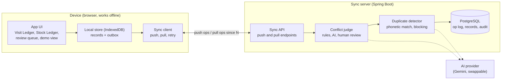

# Doppelgänger architecture

Offline-first sync skeleton with a three-tier Conflict Judge and duplicate record detection.
Kiroween 2026, Skeleton Crew category.

## 1. Overview

Each field worker's phone runs a browser app (PWA) that works fully offline. A Spring Boot server receives changes when a device has signal, resolves conflicts and duplicates, and sends the agreed result back to every device.



## 2. Core idea: one shared operation log

- Every change is an **operation**: one field of one record changed to a new value.
- The server keeps an **append-only operation log** in PostgreSQL. It is the single source of truth.
- Devices never sync directly with each other. They push their operations to the server and pull everything after the last log position they saw.
- Every resolution (rule, AI or human) is written to the log as a **new operation**. All devices replay the same log, so all devices end up identical, and the AI is never called twice for the same decision.

### Operation format

```json
{
  "opId": "uuid (unique, makes resend safe)",
  "deviceId": "device-a",
  "recordType": "patient",
  "recordId": "uuid",
  "field": "medicineDose",
  "kind": "set | create | delete",
  "value": "5 mg",
  "baseVersion": 12,
  "hlc": "2026-11-20T10:15:03.120Z-0004-device-a"
}
```

- `baseVersion`: the last server version of the record the device had seen before editing. Used for three-way comparison.
- `hlc`: hybrid logical clock timestamp (physical time + counter + device ID). Orders operations correctly even when a phone's clock is wrong.

## 3. End-to-end flow

1. **Edit offline.** The app saves the change to IndexedDB immediately and adds an operation to the outbox. The UI never waits for the network.
2. **Push.** When online, the sync client sends outbox operations in order. Operations already seen by the server (same `opId`) are ignored, so resending is safe.
3. **Three-way compare.** For each operation the server compares the base value, the current server value and the incoming value:
   - Only one side changed the field: apply it.
   - Both changed it to the same value: nothing to resolve.
   - Both changed it to different values: raise a **conflict**.
4. **Judge.** The conflict goes through the tier set by the field's merge policy (section 4).
5. **Duplicates.** New records are checked by the duplicate detector (section 5).
6. **Log.** Accepted changes and resolutions are appended to the operation log, with an audit entry for each resolution.
7. **Pull.** Devices request operations after their last log position and apply them locally. Disputed fields are shown as "disputed" until a reviewer decides.

### Deletes

- Deletes create a **tombstone** instead of removing the row, so the deletion reaches every device.
- Delete on one device + edit on another: keep the record with the edit, mark it "deleted elsewhere", and send it to the review queue.

## 4. Conflict judge

| Tier | Handles | How |
|---|---|---|
| 1. Rules | `counter`, `set-union`, `append-only`, `latest` fields | Deterministic code. Counter: combine both deltas (10 − 2 − 3 = 5). Set: union. Append-only: keep both, ordered by HLC. Latest: higher HLC wins. |
| 2. AI judge | `ai-judge` fields (free text, judgement) | AI gets base value, both values, field description and timestamps. Must return JSON: proposed value, confidence 0–1, explanation. Low confidence or invalid output goes to tier 3. |
| 3. Human review | `critical` fields (dose, price), invariant violations, low-confidence AI answers, delete-versus-edit | Never auto-applied. Field marked disputed on every device; reviewer sees both values, who recorded them, when, and an AI-written summary. |

After every tier-1 merge the domain invariants are checked (for example `quantity >= 0`). A violation sends the conflict to review instead.

### AI provider interface

```java
public interface AiJudgeProvider {
    FieldVerdict resolveField(FieldConflict conflict);   // tier 2 conflicts
    MatchVerdict judgeDuplicate(DuplicatePair pair);     // uncertain duplicates
}
```

- `GeminiJudgeProvider`: real implementation, structured JSON output.
- `FakeJudgeProvider`: deterministic, used by property-based tests so 10,000 scenarios run fast and repeatably.
- Only the fields needed for a decision are sent to the AI. Demo data is fictional.

## 5. Duplicate detector

Finds the same person or item registered separately on two devices (for example "Ramesh Kumar, 45, Rampur" and "Ramesh Kumaar, 46, Rampur").

1. **Blocking.** Only compare records that share a block key (for example same village + phonetic key of the first name). Avoids comparing every record with every other record.
2. **Field matching** by the method declared in the domain spec:
   - `exact` (village, unit size)
   - `phonetic` (names; handles Indian name spelling variants like Kumar/Kumaar, Mohd/Mohammad)
   - `numeric-tolerance` (age within 2 years)
   - `ai-judge` (product names like "Parle-G 100g" vs "parle g biscuit small")
3. **Match score** 0–1, then three bands:
   - Above auto-merge threshold: merge automatically.
   - Between review and auto-merge thresholds: ask the AI judge (yes/no + confidence + explanation).
   - Below review threshold: treat as different.
4. **Safety.** If any `critical` field differs, never merge automatically; send to review.
5. **Merging** combines fields using each field's merge policy, keeps both old IDs in `record_aliases` so later operations still find the record, and is always reversible. "Not the same" decisions are remembered.

## 6. Domain spec (YAML)

App-specific behaviour lives only in a YAML file and UI screens. The sync engine, judge and duplicate detector are shared.

```yaml
recordType: patient
fields:
  name:          { type: string, policy: latest }
  visitNotes:    { type: text,   policy: append-only }
  symptoms:      { type: set,    policy: set-union }
  medicineDose:  { type: string, policy: critical }
  followUp:      { type: text,   policy: ai-judge, description: "Advice for the next visit" }
  age:           { type: int,    policy: latest }
  village:       { type: string, policy: latest }
identity:
  name:    { match: phonetic }
  age:     { match: numeric-tolerance, tolerance: 2 }
  village: { match: exact }
blockingKey: [village, name.phonetic]
thresholds: { review: 0.6, autoMerge: 0.9 }
```

Stock Ledger uses the same format with `quantity` as a `counter` (invariant `quantity >= 0`), `price` as `critical`, and `supplierNotes` as `ai-judge`.

## 7. Sync API

| Method | Endpoint | Purpose |
|---|---|---|
| POST | `/api/sync/push` | Device sends outbox operations. Returns accepted op IDs. |
| GET | `/api/sync/pull?since={logPosition}` | Returns all operations after the given log position. |
| GET | `/api/review` | Open review queue items. |
| POST | `/api/review/{id}/decide` | Reviewer picks a value, approves/rejects a merge, or confirms a delete. |
| POST | `/api/duplicates/{id}/undo` | Undo a duplicate merge. |
| GET | `/api/records/{type}/{id}/history` | Resolution history for one record. |

## 8. Database tables

| Table | Contents |
|---|---|
| `operations` | Append-only log; position, opId (unique), device, record, field, value, base version, HLC |
| `records` | Current materialised state of each record, version, tombstone flag |
| `conflicts` | Detected conflicts and their status |
| `review_queue` | Items waiting for a human, with AI summary |
| `resolutions` | Audit trail: values, base, tier, final value, explanation (never deleted) |
| `record_aliases` | Old record IDs pointing to the merged record |
| `duplicate_decisions` | Remembered "same" / "not the same" decisions |

## 9. Testing architecture

- **Simulator:** in-memory fake devices (each with its own store and outbox) and a fake network that can drop a sync halfway or deliver a batch twice. It uses the real server merge engine, so tests prove the actual code.
- **Property-based tests (jqwik):** 10,000+ generated scenarios with 3+ devices, random edits, deletes, clock skew, duplicate registrations, interrupted and repeated syncs.
- **Properties checked:**
  - Convergence: all devices identical after a full sync.
  - No data loss: every acknowledged operation is still reflected.
  - Idempotency: syncing a batch twice equals syncing it once.
  - Safety: a conflicting `critical` field is never auto-changed.
- **Shrinking:** a failing scenario is reduced to the smallest reproducing case.
- **Judge evaluation set:** 30+ hand-written conflict and duplicate cases in `eval/`, scored against expected outcomes, with a separate check that every critical case went to review.
- Results are published in the README.

## 10. Tech stack

| Layer | Choice |
|---|---|
| Backend | Java 21, Spring Boot 3, Maven |
| Database | PostgreSQL (H2 for local dev) |
| Frontend | TypeScript PWA, IndexedDB |
| AI | Gemini via `AiJudgeProvider` interface |
| Tests | JUnit 5, jqwik |
| Deploy | Server + static client on a free host (for example Render) |

## 11. Folder structure

Skeleton Crew rules require two separate app folders, one per application.

```
doppelganger/
├── .kiro/
│   ├── specs/          requirements, design, tasks
│   ├── steering/       product, tech and structure rules
│   └── hooks/          spec-to-code and test hooks
├── skeleton/
│   ├── server/         shared Spring Boot: sync API, judge, duplicates, simulator
│   └── sync-client/    shared TypeScript sync library (IndexedDB, outbox, push/pull, HLC)
├── visit-ledger/       app 1: domain spec YAML + screens
├── stock-ledger/       app 2: domain spec YAML + screens
├── demo/               side-by-side simulated devices view
├── eval/               hand-written judge cases
└── docs/               ARCHITECTURE.md, DEVPOST_STORY.md
```

## 12. Build order

1. Operation log, push/pull, three-way compare, tier-1 rules, HLC, tombstones.
2. Simulator and property-based tests (catch sync bugs early).
3. Domain spec loader and both demo apps.
4. Tier 2 AI judge and tier 3 review queue.
5. Duplicate detector.
6. Demo view, evaluation set, README results, deploy, video.

If time runs short, cut duplicate detection down to phonetic matching + human review; keep everything else.
